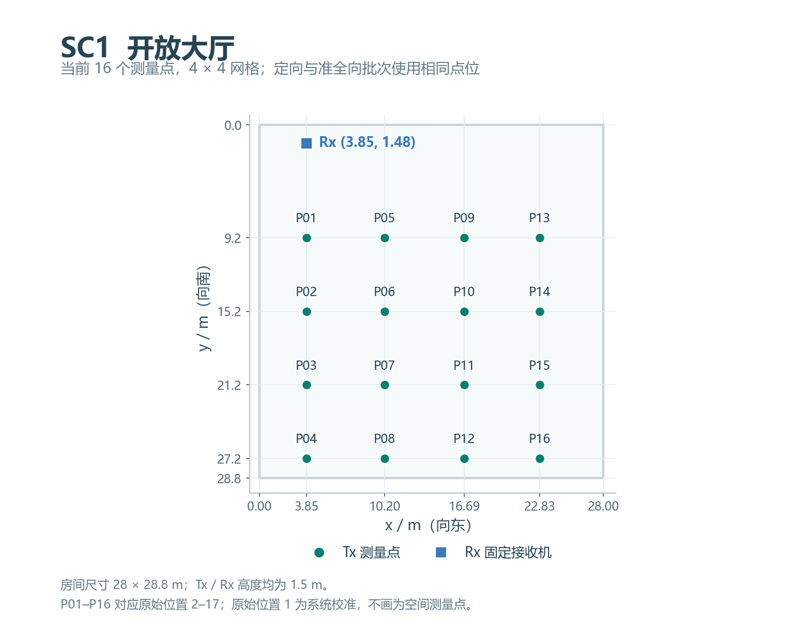
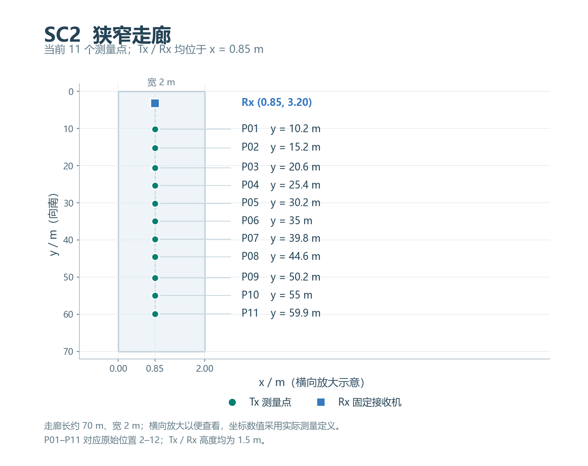
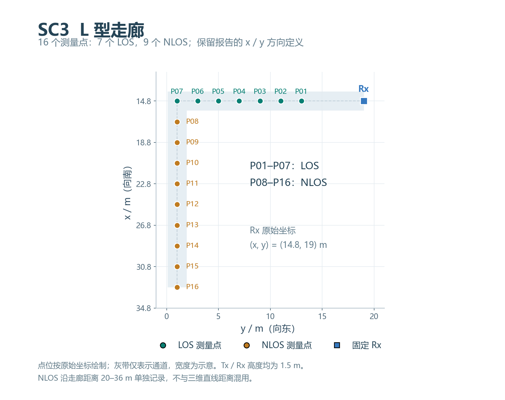
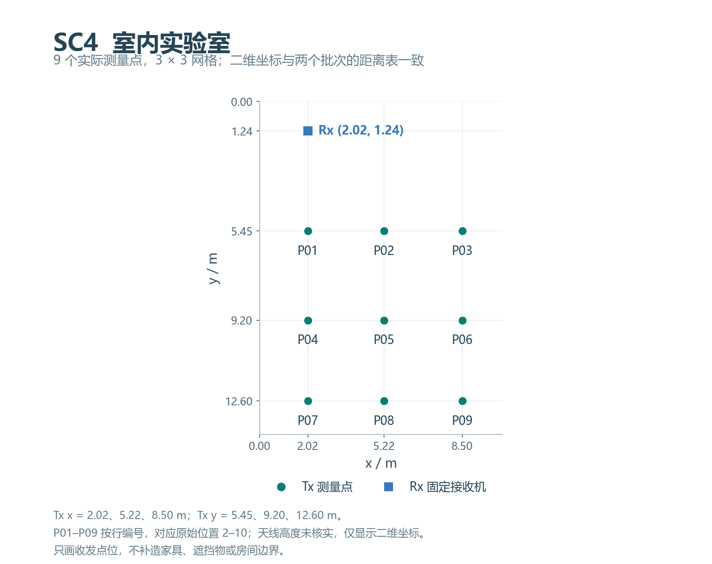
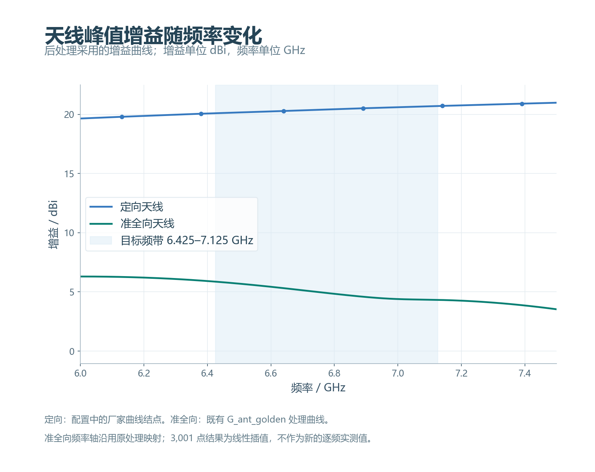

# SC1–SC4 信道测量数据集

本仓库整理 2026 年 8 月采集的 **6–7.5 GHz** 信道测量数据，包含原始 S21/TDR、采集配置、逐次参数、大尺度与小尺度分析结果，以及已核对的场景坐标。仓库为 **私有**；太赫兹测量尚未提供，目前仅预留扩展说明。

**完整数据下载：[数据 Release · data-2026-08-v1](https://github.com/Chengsong-Fu/channel-measurements/releases/tag/data-2026-08-v1)**。普通的 GitHub “Download ZIP” 或 `git clone` 只包含说明、目录、示例和精选报告图，不包含完整原始 MAT；请按下方步骤下载 Release 附件。

## 数据范围

| 场景 | 名称 | 测量点数 | 天线批次 | 原始采集记录 | 逐次处理参数记录 |
|---|---|---:|---|---:|---:|
| SC1 | 开放大厅 | 16 | 定向、准全向 | 3,400 | 28,800 |
| SC2 | 狭窄走廊 | 11 | 定向、准全向 | 2,400 | 19,800 |
| SC3 | L 型走廊 | 16 | 定向、准全向 | 3,400 | 28,800 |
| SC4 | 室内实验室 | 9 | 定向、准全向 | 2,000 | 16,200 |
| 合计 | 4 个场景、8 个批次 | 52 | 每场景各 2 批 | **11,200** | **93,600** |

每批在各位置重复采集 100 次。原始记录包括 **800 条校准记录**；实际场景测量为 10,400 条。93,600 条参数记录是 10,400 条场景测量在 9 个处理频带下的展开，不能当成 93,600 次独立原始采集。

本次保留 **3,846 个科学数据与结果文件，13,219,409,614 字节（约 13.22 GB / 12.31 GiB）**。排除 431 个 MATLAB 临时工作进程、偏好、证书及缓存文件，共 466,327 字节；原始目录中的科学文件内容不改写。完整文件清单与 SHA-256 在 [metadata/files.csv](metadata/files.csv)。

## 场景示意图

按当前采集点位重新绘制。SC4 二维坐标已从后处理配置中找回，并与两个批次的 9 个距离逐点核对。完整坐标说明和大图见 [场景与点位](docs/SCENARIOS.md)。

| SC1 开放大厅 · 16 点 | SC2 狭窄走廊 · 11 点 |
|---|---|
| [](report/sc1-layout.png) | [](report/sc2-layout.png) |
| **SC3 L 型走廊 · 16 点** | **SC4 室内实验室 · 9 点** |
| [](report/sc3-layout.png) | [](report/sc4-layout.png) |

## 天线方向图与频率增益

[查看两副天线的 E/H 面方向图、频率增益曲线及 CSV 数值表](antenna/README.md)。方向图标明源图频率和数字化来源；增益表区分原始结点、既有处理频率映射与插值结果。



## 目录

```text
metadata/
  campaigns.json          八个批次的频率、点数、天线和仪器配置
  measurements.csv        11,200 次原始采集的可搜索目录及坐标
  points.csv              场景点位与原始数组索引、Tx/Rx 坐标
  files.csv               每个科学文件的恢复路径、字节数和 SHA-256
  result-tables.csv       原始结果 CSV 的路径、行数和字段
  archives.json           Release 分卷顺序、大小与校验信息
  summary.json            数据量及排除规则的统计
report/                   SC1–SC4 简化场景图、核对坐标、报告大尺度结果
antenna/                  两副天线的方向图、增益曲线、数据表与来源说明
examples/                 每个场景定向批次 P03 第 12 次采集的真实导出
scripts/                  下载、校验恢复、目录查询和单次数据读取
docs/DATA_FORMAT.md       数据格式、字段、数组维度和单位
docs/SCENARIOS.md         场景布局与距离的适用范围
docs/PROVENANCE.md        数据来源、保留/排除规则及结果口径
terahertz/README.md       后续太赫兹数据的预留位置
data/                     下载恢复后生成；不进入 Git 历史
  sc1/sc1_20260811_112618/
    03_hall_directional/*.mat
    Postprocessing_Results/...
  sc1/sc1_20260812_090646/...
  sc2/sc2_20260813_095704/...
  sc2/sc2_20260814_093939/...
  sc3/sc3_20260817_095203/...
  sc3/sc3_20260818_094059/...
  sc4/sc4_20260807_150330/...
  sc4/sc4_20260810_102021/...
```

## 下载与使用

需要 Python 3.10+。请先使用有权限的 GitHub 账号登录 Git Credential Manager 或 GitHub CLI；也支持在自己终端的环境变量中配置 `GH_TOKEN` / `GITHUB_TOKEN`。脚本不会把令牌写入文件或打印出来。

```bash
git clone https://github.com/Chengsong-Fu/channel-measurements.git
cd channel-measurements
python -m pip install -r requirements.txt

# 先只下载并恢复一个场景
python scripts/download_data.py --scenario sc1

# 下载并恢复全部八批次
python scripts/download_data.py
```

也可在 Release 页面手动下载某批次的 **全部 `.zip.001`、`.zip.002` 等分卷** 到 `downloads/`，再运行：

```bash
python scripts/restore_data.py --archive-dir downloads --scenario sc1
```

脚本会按清单验证分卷、合并 ZIP、解压并验证每个文件的原始 SHA-256。每卷不超过 1 GiB；共有 17 卷。分卷是同一个标准 ZIP 的连续字节段，不是可分别解压的 ZIP。恢复过程需额外空间：全部文件约 13.22 GB，下载分卷约 13.22 GB，临时合并一个批次约 2.3 GB，建议留出 **至少 32 GB** 空闲空间。下载脚本可复用已校验附件及续传部分下载。

无需下载完整数据也可查询目录：

```bash
python scripts/search_catalog.py --scenario sc1 --point P03 --repeat 12
python scripts/search_catalog.py --scenario sc2 --distance-min 10 --distance-max 30
```

恢复数据后导出单次采集的全部 3,001 频点：

```bash
python scripts/read_capture.py --scenario sc1 --point P03 --repeat 12 --antenna directional --output selected.csv
```

字段、格式和 MATLAB/Python 读取方式见 **[数据格式说明](docs/DATA_FORMAT.md)**。`examples/` 是可直接查看的真实采集导出。

## 坐标与结果约定

- P01 对应原始位置索引 2；原始位置 1 是校准点 `CAL`。点位、数组索引和原始标签分别保留。
- 原始标签如 `4m` 是历史采集位置标签，**不是实际收发距离**。统一使用 `metadata/points.csv` 中的三维坐标计算直线距离。
- SC1 使用当前 16 点布局，首列 Tx x=3.85 m。报告大厅原图是早期 12 点图；SC2 原图是早期 10 点图，当前为 11 点。
- SC3 的三维直线距离和沿走廊距离分别记录。NLOS 沿走廊 20–36 m 不能作为直线距离。
- SC4 二维坐标已通过两批位置映射核对；`horizontal_distance_m` 记录平面直线距离。高度尚未核实，z 坐标及三维 `distance_m` 留空。
- **sc 开头的采集源目录中的大小尺度结果均保留**。`report/` 只收录报告中已完成的大尺度结果和场景图，不收录报告中不正确的小尺度图，也不上传包含这些图的完整 Word 文档。
- 报告统一汇总表、历史分批次拟合和原始后处理结果各有统计口径，分别保存，不混用系数或重新拟合。

详见 [场景与距离](docs/SCENARIOS.md)、[来源与处理说明](docs/PROVENANCE.md)。数据未附加开放许可；私有访问不等于获得对外发布或再分发授权。

场景与天线图的可编辑矢量版本为同名 SVG。复现绘图：安装 `requirements-figures.txt`，再运行 `python scripts/draw_figures.py`；中文字体可使用 Microsoft YaHei 或 Noto Sans CJK SC。
