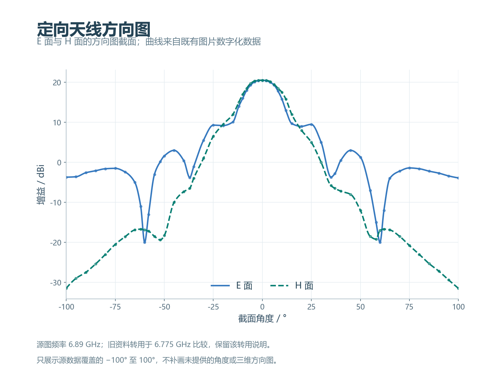
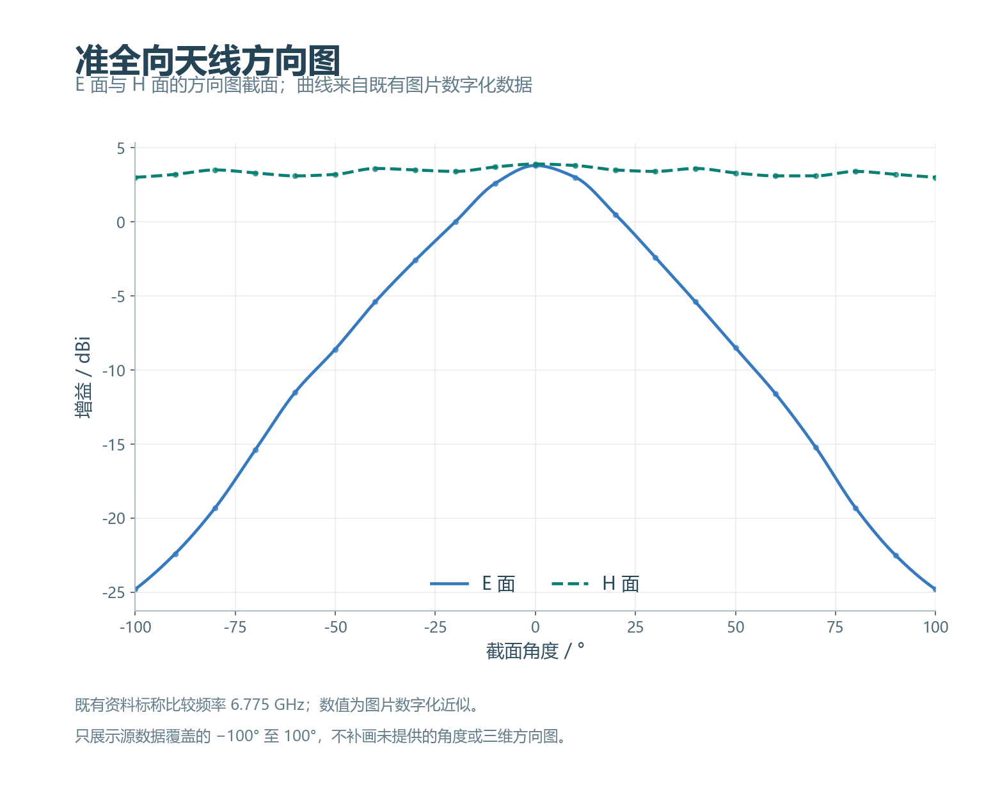
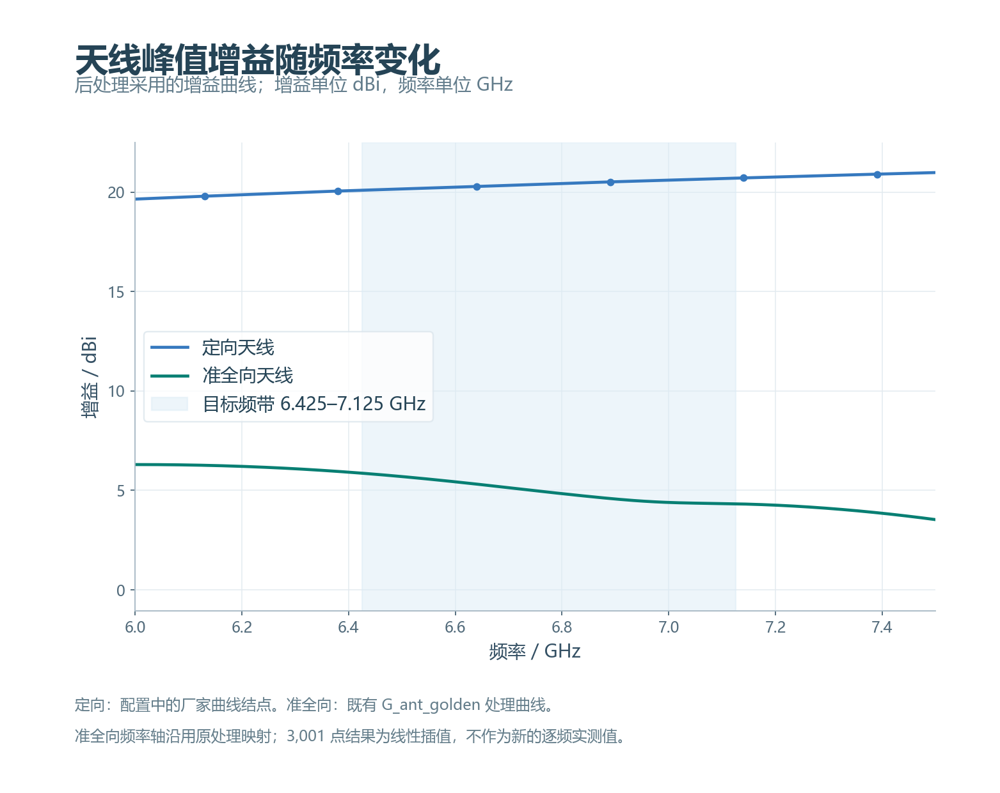
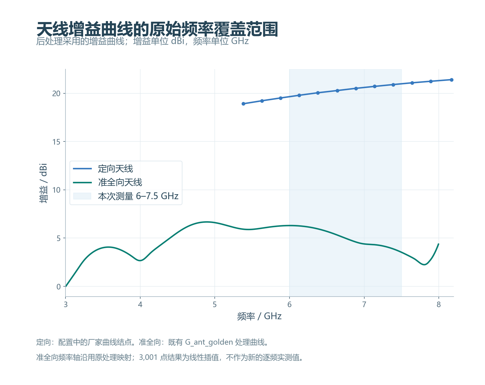

# 两副天线的方向图与频率增益

这里展示本次测量后处理与已有论文资料中使用的定向天线、准全向天线数据。方向图为既有图片的数字化截面，增益曲线为处理配置及 MAT 文件中保留的数值；各自来源分别记录在 [provenance.json](provenance.json)。

## 定向天线方向图

[SVG 矢量图](directional-pattern.svg) · [方向图样本 CSV](data/directional-pattern.csv) · [原有来源记录](data/directional-pattern-provenance.json)

源图频率标签为 **6.89 GHz**。旧论文资料按作者要求将其转用于 **6.775 GHz** 的比较，这里保留该转用关系，图中标注原始频率。E/H 面数据覆盖 −100° 至 100°，曲线采用 PCHIP 连接已有数字化结点。样本是图片读取近似，不能作为新完成的逐点暗室扫描。

## 准全向天线方向图

[SVG 矢量图](quasi-omni-pattern.svg) · [方向图样本 CSV](data/quasi-omni-pattern.csv) · [原有来源记录](data/quasi-omni-pattern-provenance.json)

原有来源记录将此天线标为 **UWB DeepAce2**，名义比较频率为 **6.775 GHz**。当前截面仅覆盖 −100° 至 100°，包含 E 面与 H 面的已有数字化数据；不延伸为未提供的全角度或三维方向图。

## 各频率增益结果

[测量频带 SVG](gain-measurement-band.svg) · [3,001 频点插值数值表](data/gain-on-measurement-grid.csv) · [关键频率数值表](data/gain-key-frequencies.csv)

| 天线 | 既有源数据 | 频率定义 | 导出数据 |
|---|---|---|---|
| 定向 | `Postprocessing_plan_config.m` 的厂家曲线，12 个结点 | 5.38–8.17 GHz，源频率明确 | [原结点 CSV](data/directional-gain-native.csv) |
| 准全向 | `gain_ant_3000to8000.mat:G_ant_golden`，998 个值 | 沿用处理频率轴 `linspace(3,8,1000)[1:-1]` | [处理频率映射 CSV](data/quasi-omni-gain-processing-grid.csv)、[原 MAT](data/gain_ant_3000to8000.mat) |

下表和 3,001 点 CSV 分别对两条源曲线作**线性插值**，不外推。CSV 的采样网格为 6–7.5 GHz、步长 0.5 MHz，与原始信道测量频率一致；这些密集结点属于插值结果。增益单位为 dBi，完整精度保存在 CSV 中。

<!-- GAIN_TABLE -->
| 频率 / GHz | 定向增益 / dBi | 准全向增益 / dBi |
|---:|---:|---:|
| 6.000 | 19.6544 | 6.3002 |
| 6.425 | 20.0998 | 5.8665 |
| 6.475 | 20.1440 | 5.7559 |
| 6.575 | 20.2325 | 5.5021 |
| 6.675 | 20.3222 | 5.2124 |
| 6.750 | 20.3912 | 4.9852 |
| 6.775 | 20.4142 | 4.9106 |
| 6.875 | 20.5062 | 4.6303 |
| 6.975 | 20.5880 | 4.4243 |
| 7.075 | 20.6680 | 4.3488 |
| 7.125 | 20.7080 | 4.3253 |
| 7.500 | 20.9892 | 3.5312 |
<!-- /GAIN_TABLE -->

准全向 MAT 原文件未单独保存频率轴，目前使用的是既有后处理中的频率映射，尚未与独立原始天线频率记录逐点复核。方向图与频率增益来自不同资料，保留各自的数值及来源，不将它们混同为同次暗室测量。

## 完整频率覆盖范围

[SVG 矢量图](gain-full-range.svg)

阴影区为本次信道测量的 6–7.5 GHz 范围。定向曲线只画已有的 5.38–8.17 GHz，准全向曲线只画既有 998 点覆盖范围；图示之外不补造增益。

## 数据字段

- `*-pattern.csv`：`angle_deg`、`e_plane_gain_dbi`、`h_plane_gain_dbi`。
- 原增益结点表：`frequency_ghz`、`gain_dbi`。
- 插值表与关键频率表：`frequency_hz`、`frequency_ghz`、`directional_gain_dbi`、`quasi_omni_gain_dbi`。

重绘方法：安装仓库根目录的 `requirements-figures.txt`，运行 `python scripts/draw_figures.py`。PNG 用于直接预览，SVG 用于缩放和排版。
