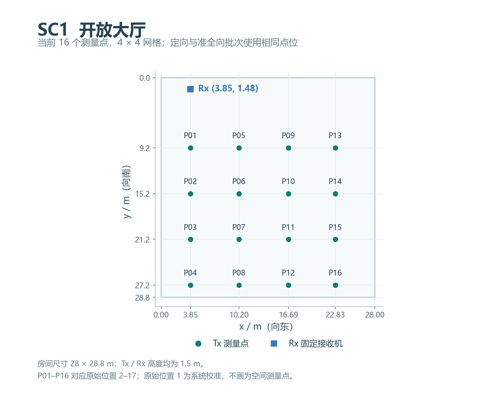
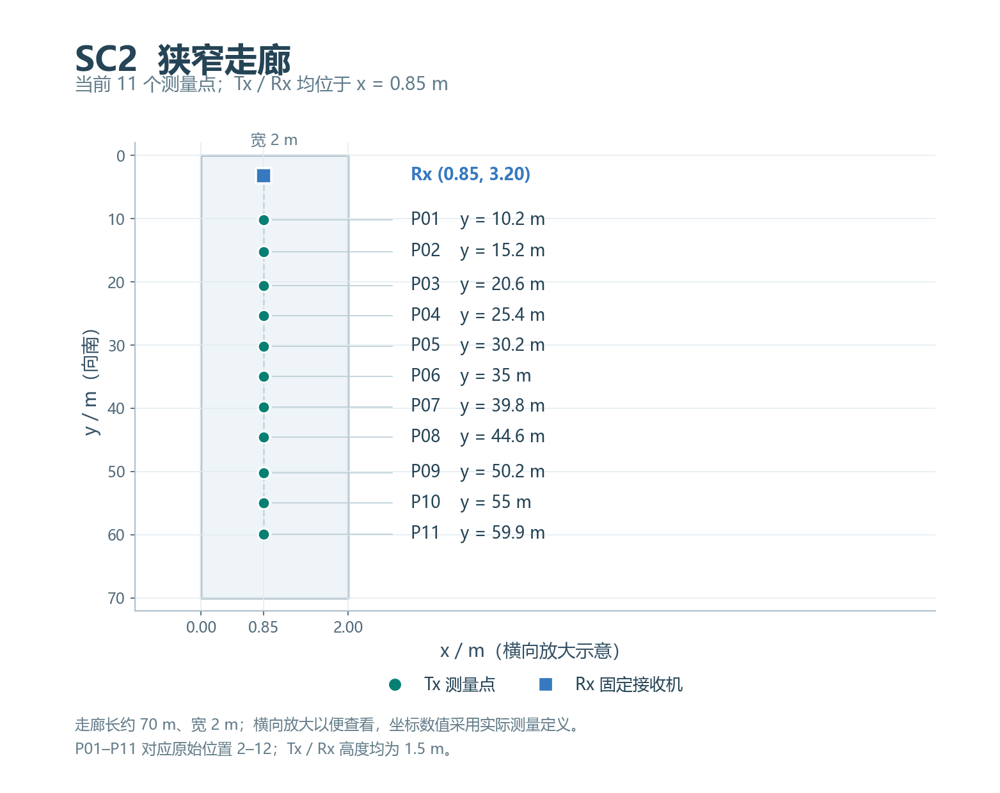
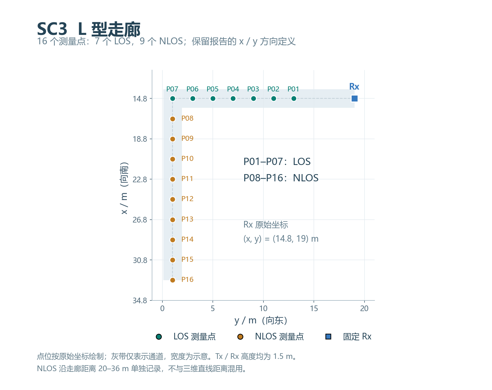
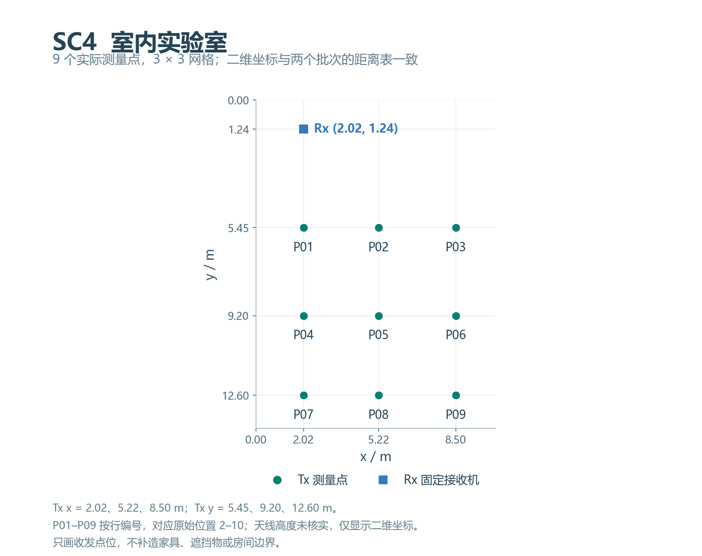

# 场景、点位与收发距离

所有坐标单位为 m。直线距离为 `sqrt((Tx_x-Rx_x)^2+(Tx_y-Rx_y)^2+(Tx_z-Rx_z)^2)`。完整点位表见 [points.csv](../metadata/points.csv)，适用批次见 [campaigns.json](../metadata/campaigns.json)。

| 场景 | 原始位置数（含校准） | 当前测量点 | 坐标/布局 |
|---|---:|---|---|
| SC1 开放大厅 | 17 | P01–P16 | 4×4 Tx 网格，固定 Rx；均高 1.5 m |
| SC2 狭窄走廊 | 12 | P01–P11 | 同一直线上的 11 个 Tx，固定 Rx；均高 1.5 m |
| SC3 L 型走廊 | 17 | P01–P16 | P01–P07 为 LOS，P08–P16 为 NLOS；均高 1.5 m |
| SC4 室内实验室 | 10 | P01–P09 | 已核对的 3×3 Tx 二维网格，固定 Rx；高度未核实 |

所有场景原始位置 1 为校准，P01–Pnn 对应原始位置 2–(nn+1)。例如 P03 对应原始位置 4，第 12 次采集在 h5py 中读取 `S21[:,11,3]`。

## SC1

[下载 SVG](../report/sc1-layout.svg)

Rx=(3.85,1.48,1.50)。Tx x=[3.85,10.20,16.69,22.83]，y=[9.2,15.2,21.2,27.2]，z=1.50，先固定 x 遍历四个 y，再切换 x。报告正文的 x=3.85 优先于历史处理映射的 3.84。

P01 距离 7.72 m；P03 的 Tx=(3.85,21.2,1.5)，直线距离 19.72 m。新图采用当前 16 点，替代报告中的早期 12 点图。

## SC2

[下载 SVG](../report/sc2-layout.svg)

Rx=(0.85,3.2,1.5)。Tx x=0.85，y=[10.2,15.2,20.6,25.4,30.2,35.0,39.8,44.6,50.2,55.0,59.9]，z=1.5。P01 直线距离为 7.00 m。

新图采用当前 11 个测量点，替代早期 10 点版本。为便于查看，图中横向放大，坐标数值保持实际定义。

## SC3

[下载 SVG](../report/sc3-layout.svg)

Rx=(14.8,19,1.5)。P01–P07 的 Tx=(14.8,13−2i,1.5)，i=0…6；P08–P16 的 Tx=(16.8+2i,1,1.5)，i=0…8。新图保留报告坐标定义：x 向南，y 向东，灰色通道宽度仅为示意。

P08 三维直线距离为约 18.1108 m，沿走廊距离为 20 m。NLOS 沿走廊距离 20–36 m 在 `corridor_distance_m` 中单列，不覆盖 `distance_m`。历史后处理模型可能使用沿走廊距离；本次整理不重拟合已有模型。

## SC4

[下载 SVG](../report/sc4-layout.svg)

在 `VNA_channel_parameter_processing/Postprocessing_plan_config.m` 的场景几何部分找回：

- Rx=(2.02,1.24) m。
- Tx x=[2.02,5.22,8.50] m，y=[5.45,9.20,12.60] m。
- MATLAB 配置先转置网格再按列展开，对应先固定 y、遍历 x 的顺序；P01–P09 对应原始位置 2–10。

| 点位 | 原始位置 | Tx x / m | Tx y / m | 平面收发距离 / m |
|---|---:|---:|---:|---:|
| P01 | 2 | 2.02 | 5.45 | 4.2100 |
| P02 | 3 | 5.22 | 5.45 | 5.2881 |
| P03 | 4 | 8.50 | 5.45 | 7.7275 |
| P04 | 5 | 2.02 | 9.20 | 7.9600 |
| P05 | 6 | 5.22 | 9.20 | 8.5791 |
| P06 | 7 | 8.50 | 9.20 | 10.2641 |
| P07 | 8 | 2.02 | 12.60 | 11.3600 |
| P08 | 9 | 5.22 | 12.60 | 11.8021 |
| P09 | 10 | 8.50 | 12.60 | 13.0782 |

上述九个 `hypot(Tx_x−Rx_x,Tx_y−Rx_y)` 结果，与 `sc4_20260807_150330` 和 `sc4_20260810_102021` 的位置映射表均逐点一致，最大差异小于 5×10⁻¹⁴ m。原始校验信息见 [SC4 坐标来源](../metadata/sc4-coordinate-source.json)。

现有依据未核实 z 坐标，因此只补充 x/y 和 `horizontal_distance_m`；三维 `distance_m` 及 z 字段保留为空。图中不虚构家具、遮挡物或房间边界。科学数据 Release 不改写，此次补充位于仓库当前分支的图示和元数据中。
